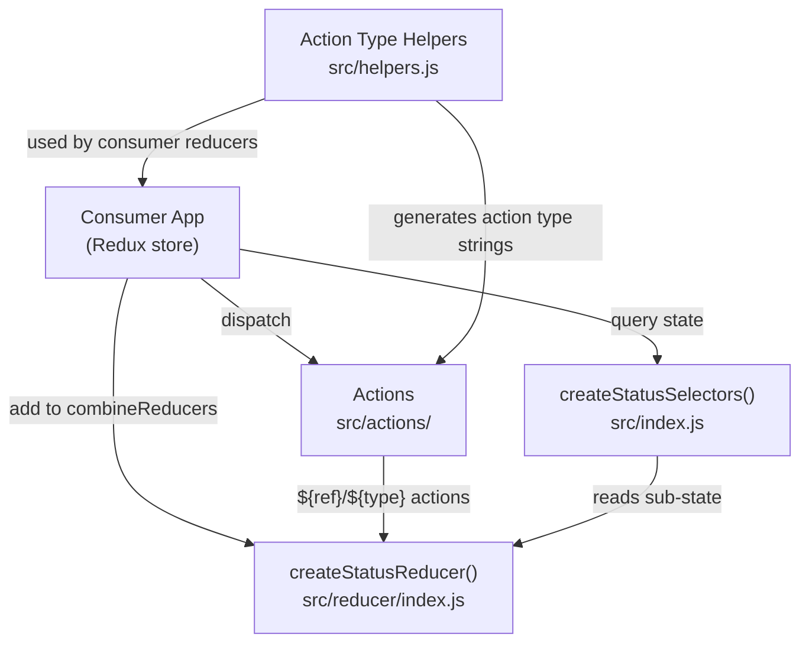

# redux-api-status Architecture

## System Overview

`redux-api-status` is a published npm library that provides Redux primitives (actions, reducers, selectors) for tracking the lifecycle of async API calls. Consumers add the reducer to their Redux store and use the provided actions and selectors to reflect pending, loaded, failed, and cancelled request states in their UI. It has a single peer dependency on Redux and an optional integration with `redux-thunk`.

## Architecture Diagram

## Component Map

| Path | Responsibility | Key Exports |
|------|---------------|-------------|
| `src/index.js` | Public API entry point | `createReducer` (default), `createStatusSelectors`, `trackStatus`, `STATUS_ACTION_TYPES`, `beginType/successType/failureType/cancelType` |
| `src/actions/actions.js` | Primitive action creators | `begin`, `success`, `failure`, `cancel` |
| `src/actions/track-status.js` | Thunk action creator wrapping the full request lifecycle | `trackStatus` |
| `src/reducer/index.js` | Combines the four sub-reducers and exports composed selectors | `reducer` (default), `selectors` |
| `src/reducer/status.js` | Tracks per-ref status string (NOT_LOADED/PENDING/LOADED/FAILED) | `statusSelectors` |
| `src/reducer/error.js` | Stores the error message for the last failed request per ref | `errorSelectors` |
| `src/reducer/timestamp.js` | Stores the timestamp of the last successful request per ref | `timestampSelectors` |
| `src/reducer/failed-count.js` | Counts consecutive failures per ref, resets on success/cancel | `failedCountSelectors` |
| `src/constants.js` | Status strings and action type constants | `NOT_LOADED`, `PENDING`, `LOADED`, `FAILED`, `STATUS_ACTION_TYPES` |
| `src/helpers.js` | Functions that produce action type strings from a ref | `beginType`, `successType`, `failureType`, `cancelType` |
| `docs/` | Human-readable API documentation | — |

## Request Flow

### Using `trackStatus` (thunk path)

1. Consumer dispatches `trackStatus(getRef, getPromise, options)(...args)`
2. `trackStatus` checks if `ref` is already `PENDING` — if so, resolves `{ rejected: true }` immediately
3. If a `cache` option is set, checks timestamp; resolves `{ rejected: true }` if within cache window
4. Dispatches `begin(ref)` → reducer sets status to `PENDING`
5. Awaits the promise from `getPromise(...args)`
6. On success: dispatches `success(ref, response)` → status → `LOADED`, timestamp set, failedCount reset
7. On failure: dispatches `failure(ref, { error: err.message })` → status → `FAILED`, failedCount incremented

### Using raw actions (manual path)

Consumer dispatches `begin(ref)`, then `success(ref, payload)` or `failure(ref, { error })` or `cancel(ref)` directly.

## Key Design Decisions

### Ref-based keying
Every request is identified by a unique string (`ref`). This allows a single reducer subtree to track arbitrarily many concurrent requests without requiring per-request reducer registration.

### Action type format: `${ref}/${STATUS}`
Status actions carry the ref in the action type string (e.g. `TODO/FETCH/1/BEGIN`). This lets consumer reducers listen to specific request events using `beginType(ref)`, `successType(ref)`, etc. without tight coupling.

### Four separate sub-reducers
Status, error, timestamp, and failedCount are stored as independent sub-reducers composed with `combineReducers`. This keeps each concern isolated and testable, and avoids deeply nested state shapes.

### UMD + Babel dual build output
`yarn build:main` produces a UMD bundle via Webpack (for script-tag consumption); `yarn build:module` produces a Babel-compiled CommonJS module tree in `lib/` (for bundler consumption). The `main` field in `package.json` points to `index.js` at the root.

### Deduplication in `trackStatus`
The thunk guards against dispatching multiple in-flight requests for the same ref, preventing duplicate API calls when a component re-renders while a request is pending.

## External Dependencies

| Package | Purpose | Location |
|---------|---------|---------|
| `redux` | Peer dependency — `combineReducers` | `src/reducer/index.js` |
| `alexs-redux-helpers` | `createDynamicReducer`, `createMetaReducer`, `nestSelectors`, `action` creator | `src/reducer/*.js`, `src/actions/actions.js`, `src/index.js` |
| `babel-polyfill` | Polyfills for UMD bundle entry point | `webpack.config.js` |

## Cross-Cutting Concerns

### Configuration
No runtime configuration. Consumers configure the library at setup time via `createStatusSelectors(getState)` (where to find the status slice in state) and the `options.getStatus` argument to `trackStatus`.

### Build Output
Built artefacts go to `lib/`. This directory is gitignored and npm-ignored from source; it is populated by `yarn build` before publishing. Never edit `lib/` directly.

### Error Handling
Errors in the promise are caught in `trackStatus` and the `err.message` string is passed to `failure`. Consumers can retrieve it with `getErrorMessage(state, ref)`.
